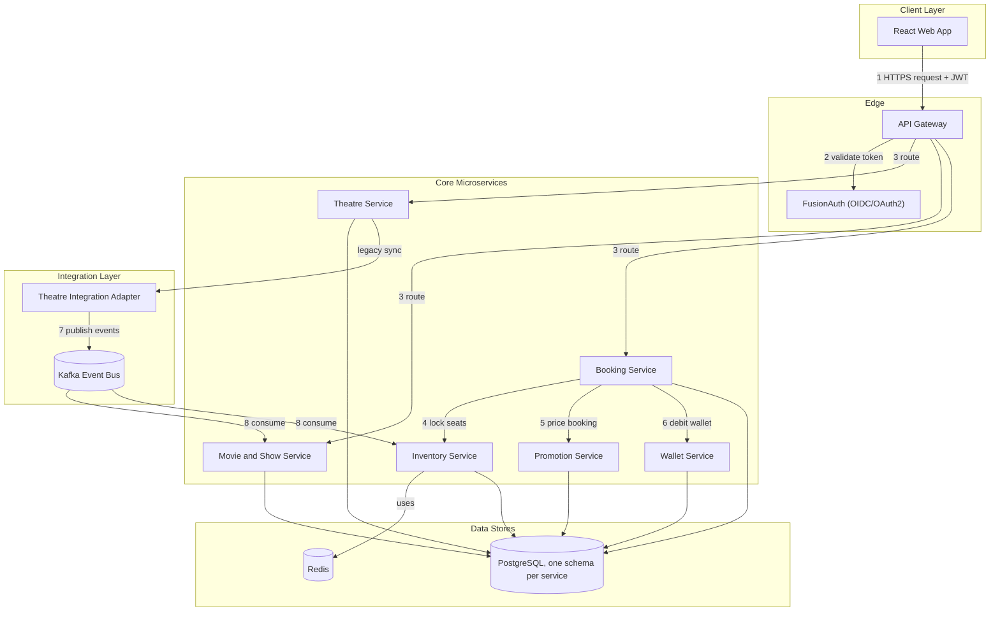
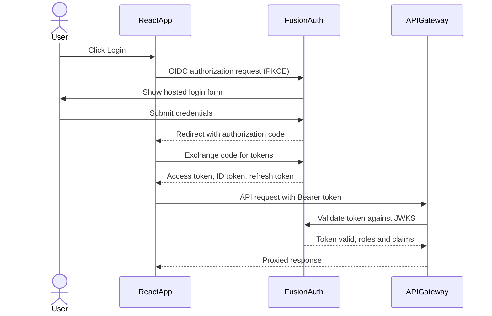
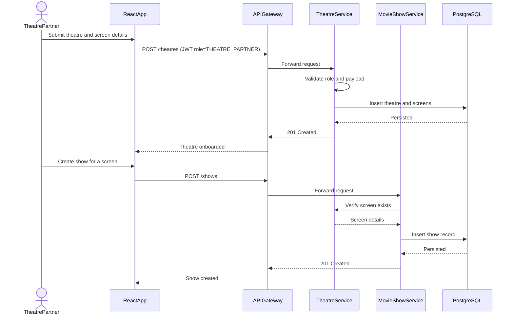
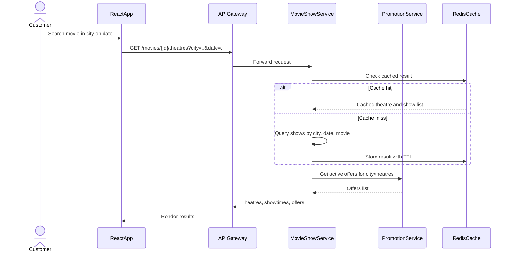
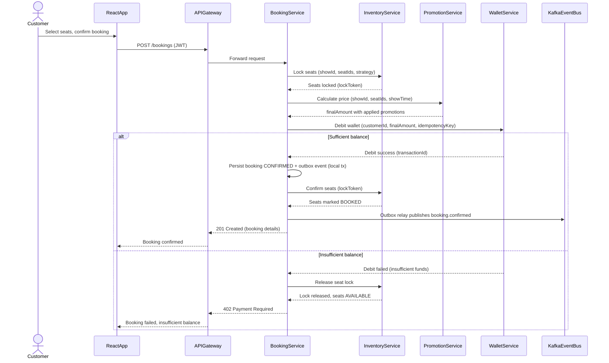
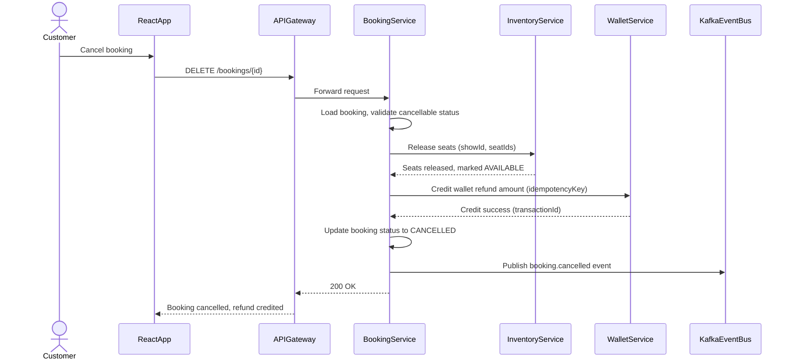
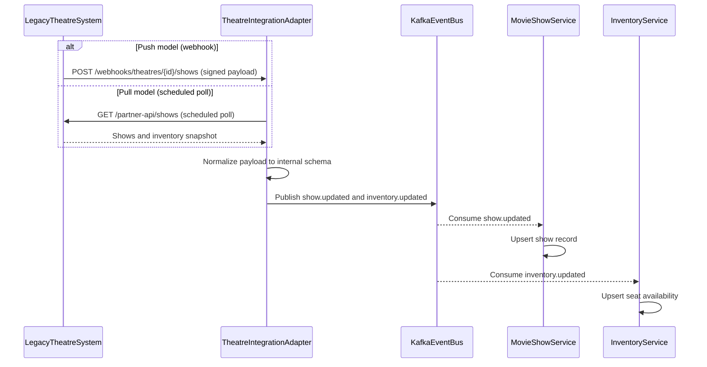
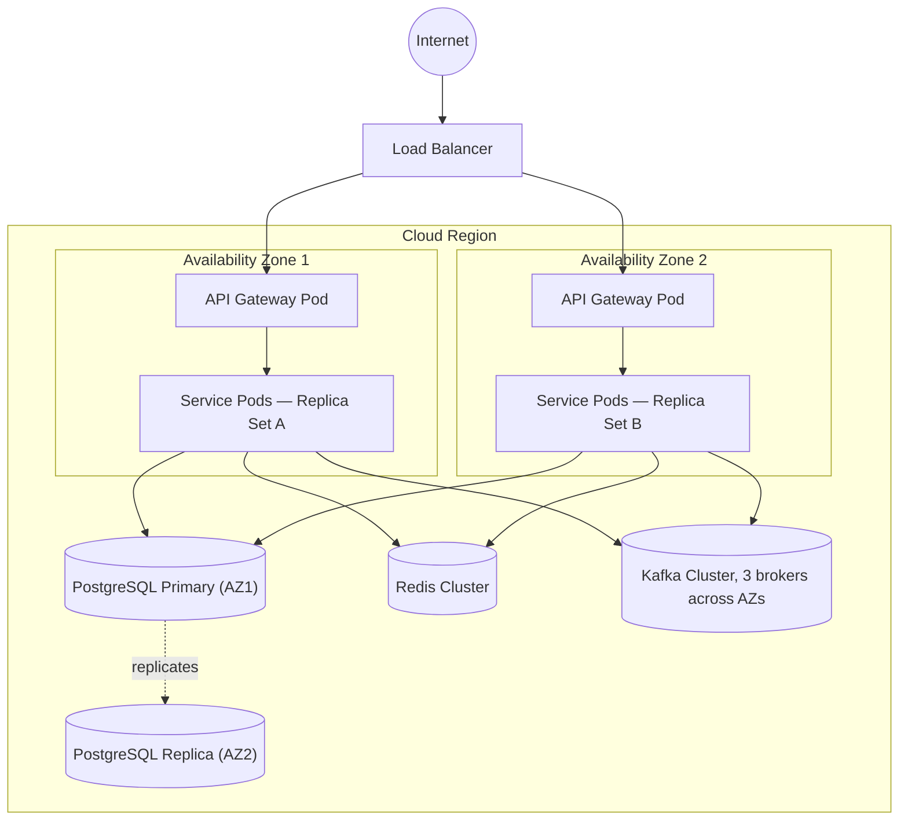

# Movie Ticket Booking Platform — Architecture

This document complements [Requirements.md](Requirements.md) and [Implementation-Plan.md](Implementation-Plan.md). It shows **what talks to what, and in what order** — a static component view plus execution-flow (sequence) diagrams for every major scenario.

## 1. Component Architecture (High-Level, Numbered Request Flow)

Edge labels are numbered to show the typical order of execution for a request originating from the UI, not just static connectivity.

## 2. Execution Flow Diagrams

### 2.1 Authentication Flow

### 2.2 Theatre Onboarding & Show Management (B2B Write)

### 2.3 Discovery / Browse Flow (B2C Read)

### 2.4 Booking Flow (Core Saga) — Critical Path

### 2.5 Cancellation & Refund Flow

### 2.6 Legacy Theatre Integration Flow

## 3. Deployment Topology (Single Region, Multi-AZ)

Notes:
- Pods are spread across AZs via `topologySpreadConstraints`/pod anti-affinity so an AZ outage doesn't take the whole fleet down.
- PostgreSQL uses a primary/replica setup within the region; Redis and Kafka run as multi-AZ clusters.
- This topology targets the 99.99% single-region availability goal from [Requirements.md §5](Requirements.md#5-non-functional-requirements) without the added complexity of multi-region/multi-cloud (explicitly out of scope for now).
