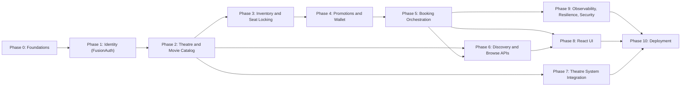

# Movie Ticket Booking Platform — Phase-Wise Implementation Plan (Detailed)

This plan sequences the build described in [Requirements.md](Requirements.md) into incremental phases. For execution-flow/sequence diagrams, see [Architecture.md](Architecture.md). Each phase lists: detailed tasks, data model (DDL), API contracts, config, package structure where relevant, testing strategy, and a Definition of Done (DoD).

## Repository Layout

```
movie-booking/
  docs/
    Requirements.md
    Implementation-Plan.md
    Architecture.md
  services/
    api-gateway/
    theatre-service/
    movie-show-service/
    inventory-service/
    booking-service/
    promotion-service/
    wallet-service/
    theatre-integration-adapter/
    common-security/        (shared JWT/role-handling lib, published to local Maven repo)
  ui/
    react-app/
  infra/
    docker-compose.yml
    fusionauth/kickstart.json
    k8s/
```

Build tool: **Maven**, multi-module with a parent POM pinning Spring Boot 3.3.x / Spring Cloud 2023.x BOM versions. Java 21 throughout.

## Phase Dependency Diagram



---

## Phase 0 — Foundations & Local Environment

**Objective**: Repo, build, and local infra in place before any business logic.

**Detailed tasks**:
1. Create the multi-module Maven layout above; parent POM with dependency management (Spring Boot, Spring Cloud, Lombok, MapStruct, Testcontainers).
2. Write `infra/docker-compose.yml` with: single PostgreSQL container + init script creating one database per service (`theatre_db`, `catalog_db`, `inventory_db`, `booking_db`, `promotion_db`, `wallet_db`, `integration_db`, `fusionauth_db`); Redis; Kafka (KRaft mode, no separate Zookeeper); FusionAuth.
3. Scaffold each service as a Spring Boot app with `/actuator/health`.
4. Build `api-gateway` on Spring Cloud Gateway with static routes (service name:port via Docker network DNS — no Eureka needed at this scale).
5. Create `common-security` module: shared JWT role-extraction converter, standard error-response DTO, `X-Correlation-Id` filter.
6. Define conventions doc (in this file, see below): error envelope, pagination, API versioning.
7. GitHub Actions workflow: `mvn -B verify` on every module on PR.
8. Root `README.md`: `docker-compose up -d` instructions and smoke-test curl commands.

**Conventions**:
- All APIs versioned under `/api/v1/...`.
- Standard error envelope: `{ "timestamp": "...", "status": 404, "error": "NOT_FOUND", "message": "...", "path": "..." }`.
- Pagination: `?page=0&size=20`, response wrapper `{ "content": [...], "page": 0, "size": 20, "totalElements": N }`.
- Every inbound request propagates/generates `X-Correlation-Id`, logged by every service for tracing.

**Port assignments (local dev)**:

| Component | Port |
|---|---|
| API Gateway | 8080 |
| FusionAuth | 9011 |
| Theatre Service | 8081 |
| Movie & Show Service | 8082 |
| Inventory Service | 8083 |
| Booking Service | 8084 |
| Promotion Service | 8085 |
| Wallet Service | 8086 |
| Theatre Integration Adapter | 8087 |
| React Dev Server | 3000 |
| PostgreSQL | 5432 |
| Redis | 6379 |
| Kafka | 9092 |

**Definition of Done**: `docker-compose up -d` brings up all infra; `curl localhost:8080/actuator/health` returns `UP`; CI pipeline green on an empty commit.

---

## Phase 1 — Identity & Access (FusionAuth)

**Objective**: End-to-end authentication/authorization before any protected business endpoint exists.

**Detailed tasks**:
1. Add FusionAuth + its own Postgres DB to `docker-compose.yml`.
2. Write `infra/fusionauth/kickstart.json` to auto-provision on first boot:
   - Application `movie-booking` (Authorization Code + PKCE grant, redirect URI `http://localhost:3000/callback`).
   - Roles: `CUSTOMER`, `THEATRE_PARTNER`, `ADMIN`.
   - A JWT populate lambda adding a `roles` claim to the access token.
   - Three seed users, one per role, for local/manual testing.
3. `api-gateway`: add `spring-boot-starter-oauth2-resource-server`; configure `issuer-uri: http://fusionauth:9011/.well-known/jwks.json`-style discovery; custom `JwtAuthenticationConverter` (in `common-security`) mapping FusionAuth's `roles` claim to Spring `ROLE_*` authorities.
4. Every downstream service also depends on `common-security` and independently validates the JWT against FusionAuth's JWKS endpoint (defense in depth — never trust the Gateway blindly).
5. Add `GET /api/v1/whoami` to each service (quick smoke-test endpoint) returning `{ "sub", "email", "roles" }`.
6. Add a Postman/Bruno collection with a pre-request script exercising Resource-Owner-Password grant (test-only) to fetch tokens per role for automated API testing (documented as test-only, not representative of the real UI login flow).

**API contract**:

| Method | Path | Auth | Response |
|---|---|---|---|
| GET | `/api/v1/whoami` | any authenticated role | `{ sub, email, roles: [] }` |

**Config** (`application.yml` snippet per service):
```yaml
spring:
  security:
    oauth2:
      resourceserver:
        jwt:
          issuer-uri: http://fusionauth:9011/.well-known/jwks.json
```

**Definition of Done**: Can complete a hosted-login OIDC flow against FusionAuth from a bare test page, obtain a JWT, call `/whoami` through the Gateway, and see the correct role for each of the 3 seed users.

---

## Phase 2 — Theatre & Movie Catalog Services (B2B Onboarding)

**Objective**: Theatre partners can onboard theatres/screens and manage shows.

### Theatre Service (`theatre_db`)

```sql
CREATE TABLE theatre_partners (
  id UUID PRIMARY KEY DEFAULT gen_random_uuid(),
  company_name VARCHAR(255) NOT NULL,
  contact_email VARCHAR(255) NOT NULL UNIQUE,
  contact_phone VARCHAR(20),
  status VARCHAR(20) NOT NULL DEFAULT 'PENDING', -- PENDING, APPROVED, SUSPENDED
  fusionauth_user_id UUID,
  created_at TIMESTAMPTZ NOT NULL DEFAULT now(),
  updated_at TIMESTAMPTZ NOT NULL DEFAULT now()
);

CREATE TABLE theatres (
  id UUID PRIMARY KEY DEFAULT gen_random_uuid(),
  partner_id UUID NOT NULL REFERENCES theatre_partners(id),
  name VARCHAR(255) NOT NULL,
  address VARCHAR(500),
  city VARCHAR(100) NOT NULL,
  country VARCHAR(100) NOT NULL,
  timezone VARCHAR(50) NOT NULL DEFAULT 'UTC',
  status VARCHAR(20) NOT NULL DEFAULT 'ACTIVE',
  created_at TIMESTAMPTZ NOT NULL DEFAULT now(),
  updated_at TIMESTAMPTZ NOT NULL DEFAULT now()
);
CREATE INDEX idx_theatres_city ON theatres(city);

CREATE TABLE screens (
  id UUID PRIMARY KEY DEFAULT gen_random_uuid(),
  theatre_id UUID NOT NULL REFERENCES theatres(id),
  name VARCHAR(100) NOT NULL,
  total_seats INT NOT NULL,
  seat_layout JSONB NOT NULL, -- e.g. [{"row":"A","seats":10,"category":"REGULAR"}]
  created_at TIMESTAMPTZ NOT NULL DEFAULT now(),
  updated_at TIMESTAMPTZ NOT NULL DEFAULT now()
);
```

### Movie & Show Service (`catalog_db`)

```sql
CREATE TABLE movies (
  id UUID PRIMARY KEY DEFAULT gen_random_uuid(),
  title VARCHAR(255) NOT NULL,
  description TEXT,
  genres VARCHAR(50)[] NOT NULL,
  languages VARCHAR(50)[] NOT NULL,
  duration_minutes INT NOT NULL,
  rating VARCHAR(10),
  release_date DATE,
  created_at TIMESTAMPTZ NOT NULL DEFAULT now()
);

CREATE TABLE shows (
  id UUID PRIMARY KEY DEFAULT gen_random_uuid(),
  movie_id UUID NOT NULL REFERENCES movies(id),
  theatre_id UUID NOT NULL, -- logical reference to Theatre Service, no cross-DB FK
  screen_id UUID NOT NULL,  -- logical reference to Theatre Service
  show_date DATE NOT NULL,
  show_time TIME NOT NULL,
  language VARCHAR(50) NOT NULL,
  base_price NUMERIC(10,2) NOT NULL,
  status VARCHAR(20) NOT NULL DEFAULT 'SCHEDULED', -- SCHEDULED, CANCELLED
  created_at TIMESTAMPTZ NOT NULL DEFAULT now(),
  updated_at TIMESTAMPTZ NOT NULL DEFAULT now()
);
CREATE INDEX idx_shows_movie_date ON shows(movie_id, show_date);
CREATE INDEX idx_shows_theatre_date ON shows(theatre_id, show_date);
```

**API contracts**:

| Method | Path | Role | Request | Response |
|---|---|---|---|---|
| POST | `/api/v1/theatres` | THEATRE_PARTNER | `{name, address, city, country, timezone}` | `201 {id, ...}` |
| POST | `/api/v1/theatres/{id}/screens` | THEATRE_PARTNER | `{name, totalSeats, seatLayout}` | `201 {id, ...}` |
| GET | `/api/v1/theatres/{id}` | any | — | `200 {theatre + screens}` |
| POST | `/api/v1/movies` | ADMIN | `{title, genres, languages, durationMinutes, rating, releaseDate}` | `201 {id, ...}` |
| POST | `/api/v1/shows` | THEATRE_PARTNER | `{movieId, theatreId, screenId, showDate, showTime, language, basePrice}` | `201 {id, ...}` |
| PUT | `/api/v1/shows/{id}` | THEATRE_PARTNER | partial fields | `200` |
| DELETE | `/api/v1/shows/{id}` | THEATRE_PARTNER | — | `204` |

**Inter-service call**: Movie & Show Service calls `GET /api/v1/theatres/{theatreId}/screens/{screenId}` (OpenFeign client) to validate the screen exists before creating a show.

**Testing**: Repository tests with Testcontainers (Postgres); contract tests per endpoint; negative tests for role enforcement (a `CUSTOMER` token must get `403` on write endpoints).

**Definition of Done**: A seeded Theatre Partner can create a theatre, a screen, and a show end-to-end through the Gateway; `GET` reflects the created records.

---

## Phase 3 — Inventory Service & Seat-Locking Strategies

**Objective**: Model seat inventory and implement/compare all three seat-locking strategies.

### Schema (`inventory_db`)

```sql
CREATE TABLE seats (
  id UUID PRIMARY KEY DEFAULT gen_random_uuid(),
  screen_id UUID NOT NULL,
  seat_number VARCHAR(10) NOT NULL,
  row_label VARCHAR(5) NOT NULL,
  category VARCHAR(20) NOT NULL DEFAULT 'REGULAR', -- REGULAR, PREMIUM, RECLINER
  UNIQUE(screen_id, row_label, seat_number)
);

CREATE TABLE show_seat_availability (
  id UUID PRIMARY KEY DEFAULT gen_random_uuid(),
  show_id UUID NOT NULL,
  seat_id UUID NOT NULL REFERENCES seats(id),
  status VARCHAR(20) NOT NULL DEFAULT 'AVAILABLE', -- AVAILABLE, LOCKED, BOOKED, BLOCKED
  version BIGINT NOT NULL DEFAULT 0, -- used by the optimistic strategy
  locked_by VARCHAR(100),
  locked_at TIMESTAMPTZ,
  price NUMERIC(10,2) NOT NULL,
  UNIQUE(show_id, seat_id)
);
CREATE INDEX idx_ssa_show ON show_seat_availability(show_id);
```

### The three strategies (behind a `SeatLockStrategy` interface)

| Strategy | Mechanism | Notes |
|---|---|---|
| **Pessimistic** | `SELECT * FROM show_seat_availability WHERE show_id=? AND seat_id IN (?) FOR UPDATE` inside a DB transaction, then update status | Simple, strongly consistent; serializes contention at the DB row. |
| **Optimistic** | `UPDATE show_seat_availability SET status='LOCKED', version=version+1 WHERE show_id=? AND seat_id=? AND version=? AND status='AVAILABLE'`; check affected-row count | No DB locks held; caller retries/fails on 0 rows affected (conflict). |
| **Distributed** | Redis `SET lock:show:{showId}:seat:{seatId} {token} NX PX 300000`; release via Lua script that checks token before `DEL` | Required once Inventory Service runs multiple instances sharing no single DB lock scope. |

Selection is driven by `inventory.lock-strategy: PESSIMISTIC|OPTIMISTIC|DISTRIBUTED` in config, so each can be swapped and load-tested independently.

**API contracts**:

| Method | Path | Request | Response |
|---|---|---|---|
| POST | `/api/v1/inventory/shows/{showId}/seats/lock` | `{seatIds: [], customerId}` | `200 {lockToken, expiresAt}` / `409 Conflict` |
| POST | `/api/v1/inventory/shows/{showId}/seats/confirm` | `{lockToken, seatIds}` | `200` (idempotent) |
| POST | `/api/v1/inventory/shows/{showId}/seats/release` | `{lockToken, seatIds}` | `200` |
| GET | `/api/v1/inventory/shows/{showId}/seats` | — | `200 {seatMap: [{seatId, status, price}]}` |

**Testing**: A JUnit/k6 concurrency harness fires N parallel "book the last seat" requests against each strategy; assert exactly one winner and measure p50/p99 latency and throughput under contention. Results documented as a short comparison write-up (interview talking point).

**Definition of Done**: All three strategies pass the "exactly one winner for the last seat" test; comparison write-up checked in under `docs/seat-locking-comparison.md`.

---

## Phase 4 — Promotion Engine & Wallet Service

### Promotion Service (`promotion_db`)

```sql
CREATE TABLE promotions (
  id UUID PRIMARY KEY DEFAULT gen_random_uuid(),
  code VARCHAR(50) NOT NULL UNIQUE,
  name VARCHAR(255) NOT NULL,
  type VARCHAR(30) NOT NULL, -- THIRD_TICKET, AFTERNOON_SHOW, CUSTOM
  discount_percent NUMERIC(5,2) NOT NULL,
  priority INT NOT NULL, -- lower value = higher precedence
  stackable BOOLEAN NOT NULL DEFAULT false,
  scope_city VARCHAR(100),
  scope_theatre_id UUID,
  active BOOLEAN NOT NULL DEFAULT true,
  created_at TIMESTAMPTZ NOT NULL DEFAULT now()
);
```

Seed data: `THIRD_TICKET` (50%, priority 10, stackable=true), `AFTERNOON_SHOW` (20%, priority 20, stackable=true) — both stackable by default per the resolved precedence design, but an Admin can flip `stackable=false` on either to make it exclusive.

**Precedence algorithm** (`PromotionCalculationService`):
1. Fetch all `active` promotions applicable to the booking context (city/theatre/show-time).
2. Sort by `priority` ascending.
3. If the first (highest-precedence) applicable promotion has `stackable=false`, apply only that one.
4. Otherwise, apply all stackable applicable promotions in priority order, each computed against the amount remaining after prior discounts.

**API**:

| Method | Path | Request | Response |
|---|---|---|---|
| POST | `/api/v1/promotions/calculate` | `{showId, seatIds, showTime, theatreId, city}` | `200 {originalAmount, discountAmount, finalAmount, appliedPromotions: [{code, amount}]}` |
| POST | `/api/v1/promotions` | ADMIN body | `201` |
| PUT | `/api/v1/promotions/{id}` | ADMIN, e.g. `{priority, stackable, active}` | `200` |

### Wallet Service (`wallet_db`)

```sql
CREATE TABLE wallets (
  id UUID PRIMARY KEY DEFAULT gen_random_uuid(),
  customer_id UUID NOT NULL UNIQUE,
  balance NUMERIC(12,2) NOT NULL DEFAULT 0,
  currency VARCHAR(3) NOT NULL DEFAULT 'USD',
  created_at TIMESTAMPTZ NOT NULL DEFAULT now(),
  updated_at TIMESTAMPTZ NOT NULL DEFAULT now()
);

CREATE TABLE wallet_transactions (
  id UUID PRIMARY KEY DEFAULT gen_random_uuid(),
  wallet_id UUID NOT NULL REFERENCES wallets(id),
  booking_id UUID,
  type VARCHAR(20) NOT NULL, -- DEBIT, CREDIT, PRELOAD
  amount NUMERIC(12,2) NOT NULL,
  balance_after NUMERIC(12,2) NOT NULL,
  idempotency_key VARCHAR(100) NOT NULL UNIQUE,
  created_at TIMESTAMPTZ NOT NULL DEFAULT now()
);
```

The `idempotency_key` uniqueness constraint is what makes the Booking Service's saga retries safe (a repeated debit/credit call with the same key is a no-op on the second attempt).

**API**:

| Method | Path | Request | Response |
|---|---|---|---|
| GET | `/api/v1/wallet/{customerId}` | — | `200 {balance, currency}` |
| POST | `/api/v1/wallet/{customerId}/preload` | `{amount}` | `200 {balance}` (demo top-up, stands in for a payment gateway) |
| POST | `/api/v1/wallet/{customerId}/debit` | `{amount, bookingId, idempotencyKey}` | `200 {transactionId, balance}` / `402 Insufficient Funds` |
| POST | `/api/v1/wallet/{customerId}/credit` | `{amount, bookingId, idempotencyKey}` | `200 {transactionId, balance}` |

**Testing**: Unit tests for the precedence algorithm (exclusive vs. stackable combinations); Wallet concurrency test (parallel debits racing a near-zero balance must never overdraw — use a DB-level conditional update: `UPDATE wallets SET balance = balance - ? WHERE id=? AND balance >= ?`).

**Definition of Done**: `/promotions/calculate` returns correct amounts for both discount rules individually and combined; Wallet never goes negative under concurrent debits in a load test.

---

## Phase 5 — Booking Service (Orchestration)

### Schema (`booking_db`)

```sql
CREATE TABLE bookings (
  id UUID PRIMARY KEY DEFAULT gen_random_uuid(),
  customer_id UUID NOT NULL,
  show_id UUID NOT NULL,
  status VARCHAR(20) NOT NULL DEFAULT 'PENDING', -- PENDING, CONFIRMED, CANCELLED, FAILED
  total_amount NUMERIC(12,2) NOT NULL,
  discount_amount NUMERIC(12,2) NOT NULL DEFAULT 0,
  final_amount NUMERIC(12,2) NOT NULL,
  lock_token VARCHAR(100),
  wallet_transaction_id UUID,
  created_at TIMESTAMPTZ NOT NULL DEFAULT now(),
  updated_at TIMESTAMPTZ NOT NULL DEFAULT now()
);

CREATE TABLE booking_seats (
  id UUID PRIMARY KEY DEFAULT gen_random_uuid(),
  booking_id UUID NOT NULL REFERENCES bookings(id),
  seat_id UUID NOT NULL,
  price NUMERIC(10,2) NOT NULL
);

CREATE TABLE outbox_events (
  id UUID PRIMARY KEY DEFAULT gen_random_uuid(),
  aggregate_type VARCHAR(50) NOT NULL,
  aggregate_id UUID NOT NULL,
  event_type VARCHAR(50) NOT NULL, -- booking.confirmed, booking.cancelled
  payload JSONB NOT NULL,
  published BOOLEAN NOT NULL DEFAULT false,
  created_at TIMESTAMPTZ NOT NULL DEFAULT now()
);
```

The **outbox pattern** is used so that "persist booking" and "emit event" are atomic (same local transaction); a polling relay (or Debezium CDC, as a stretch goal) publishes unpublished `outbox_events` rows to Kafka and marks them `published=true`.

### Saga steps (see [Architecture.md §2.4](Architecture.md#24-booking-flow-core-saga--critical-path) for the diagram)

1. Validate request; check idempotency key on the incoming booking request itself (so a retried `POST /bookings` doesn't double-book).
2. `Inventory.lock(showId, seatIds)` → `409` on failure.
3. `Promotion.calculate(showId, seatIds, showTime)` → `finalAmount`.
4. `Wallet.debit(customerId, finalAmount, idempotencyKey)`:
   - Insufficient funds → `Inventory.release(lockToken)`, mark booking `FAILED`, return `402`.
5. On debit success: persist `booking=CONFIRMED` + `booking_seats` + `outbox_events` row in one local transaction.
6. `Inventory.confirm(lockToken)` → seats flip to `BOOKED` (idempotent, keyed by `lockToken`).
7. Outbox relay publishes `booking.confirmed` to Kafka.
8. Return `201` with booking details.

Edge case called out explicitly: if step 6 fails after step 4/5 succeeded (money already debited), the booking is left `CONFIRMED` with seats still `LOCKED`; a retry-with-backoff job re-attempts `Inventory.confirm` using the stored `lock_token` until it succeeds, rather than attempting an asymmetric compensating refund. This is a deliberate discussion point on saga compensation design.

**API**:

| Method | Path | Request | Response |
|---|---|---|---|
| POST | `/api/v1/bookings` | `{showId, seatIds, idempotencyKey}` | `201 {booking}` / `402` / `409` |
| POST | `/api/v1/bookings/bulk` | `{bookings: [{showId, seatIds}, ...]}` | `201 {bookings: []}` (partial-success supported, each item reports its own status) |
| DELETE | `/api/v1/bookings/{id}` | — | `200 {refundedAmount}` |
| POST | `/api/v1/bookings/bulk-cancel` | `{bookingIds: []}` | `200 {results: []}` |
| GET | `/api/v1/bookings/{id}` | — | `200 {booking}` |

**Testing**: Integration tests (Testcontainers + WireMock stubs for Inventory/Promotion/Wallet) covering happy path, insufficient-funds path, seat-conflict path, and the step-6-failure retry path.

**Definition of Done**: A full booking can be made and paid for via Wallet end-to-end through the Gateway; a cancellation releases seats and credits the Wallet; bulk endpoints handle partial failures gracefully.

---

## Phase 6 — Discovery / Browse APIs (Read Scenarios)

**Objective**: Serve FR-5/FR-6/FR-7 efficiently.

**Caching design**: Redis key `cache:browse:{city}:{movieId}:{date}`, TTL 60s; invalidated early when the Movie & Show Service consumes a `show.updated` Kafka event for a matching city/date.

**API**:

| Method | Path | Response |
|---|---|---|
| GET | `/api/v1/movies/{movieId}/theatres?city=&date=` | theatres + showtimes |
| GET | `/api/v1/cities/{city}/offers` | active promotions for the city |
| GET | `/api/v1/theatres/{theatreId}/offers` | active promotions for the theatre |
| GET | `/api/v1/movies?city=&language=&genre=` | filtered movie list |

**Testing**: Cache-hit vs. cache-miss tests; verify cache invalidation fires correctly on a `show.updated` event.

**Definition of Done**: Browse queries return correct, promotion-annotated results; p99 latency for a cached query stays under a defined threshold (e.g., 50ms) in a local load test.

---

## Phase 7 — Theatre IT System Integration

**Objective**: Demonstrate both integration patterns from [Requirements.md §12](Requirements.md#12-theatre-it-system-integration-pattern).

### Schema (`integration_db`)

```sql
CREATE TABLE integration_configs (
  id UUID PRIMARY KEY DEFAULT gen_random_uuid(),
  theatre_id UUID NOT NULL,
  system_type VARCHAR(20) NOT NULL, -- WEBHOOK, POLL
  webhook_url VARCHAR(500),
  poll_interval_seconds INT,
  last_synced_at TIMESTAMPTZ
);

CREATE TABLE sync_logs (
  id UUID PRIMARY KEY DEFAULT gen_random_uuid(),
  theatre_id UUID NOT NULL,
  payload JSONB NOT NULL,
  status VARCHAR(20) NOT NULL, -- RECEIVED, NORMALIZED, PUBLISHED, FAILED
  created_at TIMESTAMPTZ NOT NULL DEFAULT now()
);
```

**Kafka topics**:

| Topic | Payload |
|---|---|
| `show.updated` | `{eventId, theatreId, screenId, movieExternalId, showDate, showTime, price, source}` |
| `inventory.updated` | `{eventId, showId, seatId, status}` |

**Endpoints**:

| Method | Path | Notes |
|---|---|---|
| POST | `/api/v1/integration/webhooks/theatres/{theatreId}/shows` | HMAC-signed (`X-Signature` header) push endpoint for legacy systems |
| (scheduled) | poll job per `integration_configs` row with `system_type=POLL` | calls partner's `GET /partner-api/shows` on `poll_interval_seconds` |

**Testing**: A simulated "legacy theatre system" (simple stub HTTP server) exercises both the webhook push and the scheduled pull path; assert that both eventually result in identical `show.updated`/`inventory.updated` events and identical downstream state in Movie & Show / Inventory services.

**Definition of Done**: Both integration paths produce consistent downstream state within one poll/webhook cycle; signature validation rejects tampered webhook payloads.

---

## Phase 8 — React UI

**Objective**: Usable front end for customer and theatre-partner flows.

**Package structure**:
```
ui/react-app/src/
  app/              routing, providers
  auth/             OIDC context (react-oidc-context against FusionAuth)
  features/
    browse/
    booking/
    wallet/
    theatre-admin/
  api/              axios instance with request interceptor attaching the JWT
  components/
```

**Key screens**: movie/showtime browse + filters, seat map + bulk seat selection, booking confirmation with applied-promotions breakdown, wallet balance/history + preload (demo), theatre-partner show/inventory management.

**Definition of Done**: A customer can log in via FusionAuth, browse, book, see the wallet debited, and cancel for a refund — fully through the UI; a theatre partner can log in and create/update a show.

---

## Phase 9 — Observability, Resilience & Security Hardening

**Detailed tasks**:
1. `management.endpoints.web.exposure.include=health,info,prometheus` on every service; Micrometer + Prometheus + Grafana dashboards for bookings/sec, error rate, latency, wallet transaction volume.
2. OpenTelemetry Java agent (or Spring Boot 3 native tracing) across the booking saga; Zipkin/Jaeger backend to visualize the full `Booking → Inventory → Promotion → Wallet` trace.
3. Centralized logging (JSON structured logs shipped to Loki/ELK), correlated via `X-Correlation-Id`.
4. Resilience4j circuit breakers + retries on every Feign client the Booking Service uses (example config: `failure-rate-threshold: 50`, `wait-duration-in-open-state: 10s`, `sliding-window-size: 20`).
5. API Gateway rate limiting (token-bucket per client).
6. OWASP Top 10 checklist pass: Bean Validation on every request DTO, `@PreAuthorize` on every write endpoint, no secrets in source (externalized via env vars/secret manager), dependency scanning (`mvn dependency-check`) in CI, HTTPS-only cookies/headers where applicable.

**Definition of Done**: Grafana dashboard shows live metrics during a load test; a deliberately induced Wallet-service outage triggers the Booking Service's circuit breaker (verified via logs/metrics) instead of cascading failures; OWASP checklist signed off.

---

## Phase 10 — Deployment (Single Region, Multi-AZ)

**Detailed tasks**:
1. Dockerfile per service (multi-stage build: Maven build stage → slim JRE runtime stage).
2. `infra/k8s/` manifests per service: `Deployment`, `Service`, `HorizontalPodAutoscaler`; `topologySpreadConstraints` across AZ labels; `PodDisruptionBudget`.
3. Managed PostgreSQL (primary + read replica across AZs), managed Redis cluster, managed Kafka cluster — provisioned per the target cloud provider.
4. GitHub Actions CD stage: build → push image → `kubectl apply`/Helm upgrade on merge to `main`.
5. Ingress + load balancer in front of the API Gateway Deployment.
6. Basic runbook: health-check endpoints, rollback command, dashboard links.

See [Architecture.md §3](Architecture.md#3-deployment-topology-single-region-multi-az) for the topology diagram.

**Definition of Done**: Full stack deployed to a single cloud region across at least 2 AZs; killing a pod/AZ-simulated node doesn't drop in-flight availability below target; CD pipeline deploys a change end-to-end without manual steps.

---

## Summary Table

| Phase | Focus | Primary FR/NFR Coverage |
|---|---|---|
| 0 | Foundations & local env | Architecture setup |
| 1 | FusionAuth identity | AuthN/AuthZ |
| 2 | Theatre & movie catalog | FR-1, FR-2, FR-4 |
| 3 | Inventory & seat locking | FR-3, FR-10 |
| 4 | Promotions & wallet | FR-11, FR-12, FR-13, FR-14 |
| 5 | Booking orchestration | FR-8, FR-9, FR-10, FR-11 |
| 6 | Discovery/browse APIs | FR-5, FR-6, FR-7 |
| 7 | Theatre system integration | FR-4 |
| 8 | React UI | All customer/partner FRs |
| 9 | Observability/resilience/security | NFRs |
| 10 | Deployment | Availability NFR |
