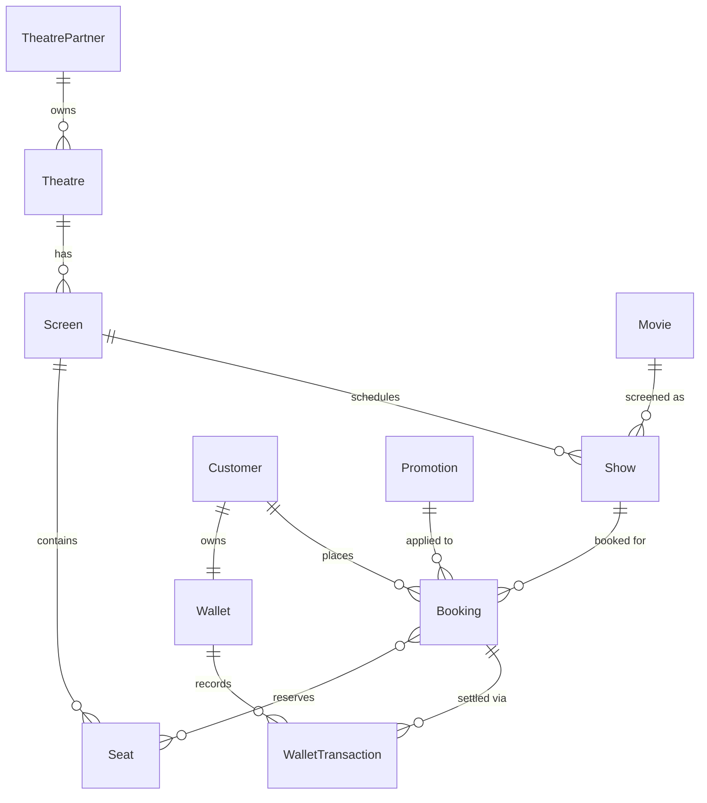
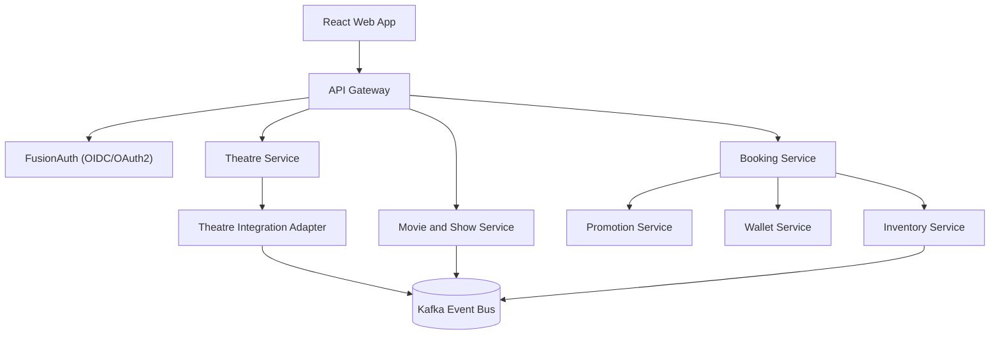

# Movie Ticket Booking Platform — Requirements

## 1. Overview

Build an online movie ticket booking platform that serves two distinct customer segments:

- **B2B — Theatre Partners**: cinema operators who onboard their theatres onto the platform to reach a larger customer base and digitize their operations (show scheduling, seat inventory, pricing).
- **B2C — End Customers**: moviegoers who browse movies across cities, languages, and genres, and book tickets in advance with a seamless experience.

The system will be built as a set of **Java microservices** with a **React** front end, using **FusionAuth** for authentication and authorization. See [Section 8](#8-system-architecture--microservices) onward for architecture details, and [Implementation-Plan.md](Implementation-Plan.md) for the phase-wise build plan.

## 2. Goals

- Enable theatre partners to self-onboard their theatres, screens, and shows, and manage seat inventory digitally.
- Enable customers to discover movies/showtimes across cities and book seats with a fast, reliable, low-friction experience.
- Provide a platform that scales across multiple cities and countries, supports localization, and remains highly available.
- Create a foundation for monetization (commission on bookings, featured listings, promotions, payment processing fees).
- Use this build as a vehicle to demonstrate and compare multiple concurrency-control and integration patterns (see [Section 10](#10-seat-locking-strategies-learning-objective) and [Section 12](#12-theatre-it-system-integration-pattern)).

## 3. User Roles / Actors

| Role | Description |
|---|---|
| **Customer** | Browses movies/shows and books/cancels tickets. Holds a wallet used to pay for bookings. |
| **Theatre Partner** | Onboards theatre(s), manages screens, shows, and seat inventory/pricing. |
| **Platform Admin** | Manages platform-wide configuration, promotions (including precedence), theatre partner approvals, and monitors operations. |
| **FusionAuth** (external IdP) | Issues and validates identity for all roles above via OAuth2/OIDC; role claims (`CUSTOMER`, `THEATRE_PARTNER`, `ADMIN`) are embedded in the JWT and enforced by each service. |

## 4. Functional Requirements

### 4.1 Theatre Onboarding & Inventory Management (B2B)

- **FR-1**: Theatre partners can register and onboard theatres, including theatre details (name, location/city, screens).
- **FR-2**: Theatre partners can create, update, and delete shows for a given day (movie, screen, timing, language, pricing).
- **FR-3**: Theatre partners can allocate seat inventory for a show and update it (e.g., block seats for maintenance, change seat categories/pricing).
- **FR-4**: The platform must support both theatres with existing IT systems (via integration/API) and new theatres (via direct onboarding UI/API), without disrupting either flow. See [Section 12](#12-theatre-it-system-integration-pattern) for the chosen pattern.

### 4.2 Movie & Showtime Discovery (B2C — Read)

- **FR-5**: Customers can browse theatres currently running a selected movie in a given town/city, including show timings for a chosen date.
- **FR-6**: Customers can view platform offers/promotions available for selected cities and theatres.
- **FR-7**: Customers can filter/search movies by city, language, and genre.

### 4.3 Ticket Booking (B2C — Write)

- **FR-8**: Customers can book movie tickets by selecting a theatre, a show timing, and preferred seats for a given day.
- **FR-9**: Customers can perform bulk booking of multiple tickets/seats in a single transaction, and bulk cancellation of previously booked tickets.
- **FR-10**: Seat selection must prevent double-booking under concurrent booking attempts. The platform will implement and compare three seat-locking strategies — see [Section 10](#10-seat-locking-strategies-learning-objective).
- **FR-11**: Cancellations must trigger inventory release and a refund credited back to the customer's **wallet** (see [Section 11](#11-wallet-based-payments-payment-gateway-stand-in)).

### 4.4 Pricing & Promotions

- **FR-12**: The platform must support a 50% discount on the third ticket within a single booking.
- **FR-13**: Tickets booked for an afternoon show must receive a 20% discount.
- **FR-14**: Promotions must be configurable with an explicit **precedence/priority** so an Admin can control which promotion applies — or in what order multiple promotions stack — when more than one is applicable to the same booking (e.g., third-ticket discount and afternoon-show discount together). See [Section 11](#11-promotion-precedence-engine) for the mechanism. *(Resolved — previously an open question.)*

## 5. Non-Functional Requirements

| Category | Requirement |
|---|---|
| **Availability** | Target 99.99% availability within a **single cloud region**, using multi-AZ deployment for redundancy. *(Resolved — multi-region/multi-cloud is explicitly deferred; see [Out of Scope](#14-out-of-scope-initial-phase).)* |
| **Scalability** | Architecture must scale horizontally (stateless microservices + externalized locking/caching) to support growth in theatres and concurrent bookings. |
| **Transactional Integrity** | Seat booking/cancellation must be atomic and consistent under concurrent access — no double-booked seats, no lost inventory updates. |
| **Authentication & Authorization** | Delegated entirely to **FusionAuth** (OAuth2/OIDC). All microservices act as OAuth2 resource servers validating JWTs issued by FusionAuth; role-based access control enforced per endpoint. |
| **Payments** | Real payment gateway integration is **out of scope** for this build. A **Wallet Service** simulates payment by debiting/crediting a pre-loaded customer balance. See [Section 11](#11-wallet-based-payments-payment-gateway-stand-in). |
| **Localization** | Must support multiple languages and locale-specific content (movie titles, descriptions, currencies) across markets. |
| **Security** | Must be designed to protect against the OWASP Top 10 threats (e.g., injection, broken auth, sensitive data exposure, broken access control). |
| **Integration** | Must support integration with theatres that already run their own IT/inventory systems, in addition to theatres onboarded natively. |
| **Monetization** | Platform must support commercial models such as booking commissions, promoted listings, and payment processing margins (conceptual — not implemented against a real gateway). |
| **Observability** | Must support monitoring of key operational and business KPIs (bookings/sec, error rates, latency, wallet transaction volume) across all microservices. |

## 6. High-Level Data Model

Core entities and relationships (one logical schema per microservice — see [Section 8](#8-system-architecture--microservices)):

- **Movie** — title, genre, language(s), duration, rating.
- **TheatrePartner** — the onboarding B2B entity that owns one or more theatres.
- **Theatre** — name, address, city, country, screens.
- **Screen** — belongs to a theatre; has seat layout/categories.
- **Show** — a scheduled screening of a Movie on a Screen at a given date/time, with pricing.
- **Seat** — belongs to a Screen; has a category (e.g., regular/premium).
- **SeatHold / SeatLock** — transient record representing an in-progress reservation on a Seat for a Show, used by whichever seat-locking strategy is active (see [Section 10](#10-seat-locking-strategies-learning-objective)).
- **Customer** — end-user account for booking (profile synced from FusionAuth identity).
- **Booking** — links a Customer to one or more Seats for a Show, with status (confirmed/cancelled) and applied promotions.
- **Promotion** — discount rule (e.g., third-ticket discount, afternoon-show discount) with a `priority` (precedence) and `stackable` flag, scoped globally or per city/theatre.
- **Wallet** — one per Customer; holds a balance used in place of a real payment method.
- **WalletTransaction** — debit/credit ledger entry against a Wallet, linked to a Booking (booking debit, cancellation refund credit).

## 7. API Surface (Indicative)

To be refined during API design, but the initial service contract should cover:

**Read (discovery) endpoints**
- `GET /movies/{movieId}/theatres?city={city}&date={date}` — theatres showing a movie in a city, with show timings for a date.
- `GET /cities/{city}/offers` and `GET /theatres/{theatreId}/offers` — active promotions for a city/theatre.

**Write (booking & management) endpoints**
- `POST /bookings` — book tickets (theatre, show, seats); internally acquires a seat lock, prices via the Promotion engine, and debits the Wallet.
- `POST /bookings/bulk` — bulk booking of multiple tickets.
- `DELETE /bookings/{bookingId}` / `POST /bookings/bulk-cancel` — single and bulk cancellation; releases seats and credits the Wallet.
- `POST /theatres/{theatreId}/shows`, `PUT /shows/{showId}`, `DELETE /shows/{showId}` — show management.
- `PUT /shows/{showId}/inventory` — seat inventory allocation/update.

**Wallet endpoints**
- `GET /wallet/{customerId}` — view balance and transaction history.
- `POST /wallet/{customerId}/preload` — add demo funds to a customer's wallet (stand-in for a real top-up/payment gateway).

## 8. System Architecture — Microservices

| Service | Responsibility | Covers |
|---|---|---|
| **API Gateway** | Single entry point for React UI; routes requests, validates FusionAuth JWTs, applies rate limiting. | Cross-cutting |
| **Theatre Service** | TheatrePartner/Theatre/Screen onboarding & management. | FR-1, FR-4 |
| **Movie & Show Service** | Movie catalog, show CRUD, discovery/browse read APIs. | FR-2, FR-5, FR-6, FR-7 |
| **Inventory Service** | Seat layout & per-show seat availability; implements all three seat-locking strategies. | FR-3, FR-10 |
| **Booking Service** | Orchestrates booking/cancellation: seat lock → pricing → wallet debit/credit → confirmation; bulk operations. | FR-8, FR-9, FR-11 |
| **Promotion Service** | Promotion rules, priority/precedence configuration, discount calculation. | FR-12, FR-13, FR-14 |
| **Wallet Service** | Customer wallet balance and transaction ledger (payment-gateway stand-in). | FR-11, NFR Payments |
| **Theatre Integration Adapter** | Bridges theatres with existing IT systems into the platform (REST + async). | FR-4 |
| **FusionAuth** | External IdP for authentication & role-based authorization (not a service we build). | NFR Auth |

Each service owns its own database (PostgreSQL) except where Redis is used for distributed locking/caching (Inventory Service). Services communicate synchronously (REST/OpenFeign) for request/response flows and asynchronously (Kafka) for integration and eventual-consistency flows.

See [Architecture.md](Architecture.md) for detailed execution-flow (sequence) diagrams of every major scenario (authentication, onboarding, discovery, booking saga, cancellation, legacy integration) and the single-region/multi-AZ deployment topology, and [Implementation-Plan.md](Implementation-Plan.md) for the phase-wise build plan with DB schemas and API contracts.

## 9. Authentication & Authorization

- **FusionAuth** is the single identity provider for all actors (Customer, Theatre Partner, Admin), used via OAuth2/OIDC.
- The React app performs an OIDC login redirect to FusionAuth and receives an access/ID token.
- The API Gateway validates the JWT on every request and forwards identity/role claims downstream.
- Each microservice is an OAuth2 **resource server**: endpoints are annotated with required roles/scopes (e.g., `THEATRE_PARTNER` for show management, `ADMIN` for promotion configuration).
- No service stores passwords; FusionAuth is the system of record for credentials, MFA, and password resets.

## 10. Seat Locking Strategies (Learning Objective)

Seat booking concurrency is addressed deliberately with **all three** common strategies, implemented behind a common `SeatLockStrategy` interface in the Inventory Service and selectable via configuration — so each can be implemented, tested under concurrent load, and compared:

1. **Pessimistic locking** — `SELECT ... FOR UPDATE` row-level lock on the seat/show-seat row for the duration of the booking transaction. Strong consistency, simplest to reason about, but reduces throughput under contention.
2. **Optimistic concurrency** — a `version` column on the seat-availability row; booking reads the version, attempts to update with a `WHERE version = ?` guard, and retries/fails on conflict. Higher throughput for low-contention cases at the cost of retry logic.
3. **Distributed locking** — a Redis-based distributed lock (Redlock-style) keyed by `showId:seatId`, needed once the Inventory Service is horizontally scaled across multiple instances/nodes that cannot rely on a single database lock alone.

A load-test harness (e.g., JMeter/k6 or concurrent JUnit tests) will exercise the same "book the last seat" scenario against each strategy to compare correctness and throughput — primarily for learning/demonstration purposes.

## 11. Promotion Precedence Engine & Wallet-Based Payments

### 11.1 Promotion precedence engine

- Each `Promotion` has a `priority` (lower = evaluated first) and a `stackable` flag.
- When a booking has multiple applicable promotions (e.g., third-ticket discount + afternoon-show discount), the Promotion Service evaluates them in priority order:
  - If the highest-priority applicable promotion is **not stackable**, only it is applied.
  - Otherwise, applicable **stackable** promotions are applied in ascending priority order, each computed against the remaining payable amount.
- Priority/stackability is configurable by an Admin, directly resolving the discount-stacking question raised earlier.

### 11.2 Wallet-based payments (payment-gateway stand-in)

- Real payment gateway integration is out of scope for this build.
- Each Customer has a **Wallet** that can be pre-loaded with demo funds (`POST /wallet/{customerId}/preload`).
- Booking debits the wallet for the final (post-discount) amount as part of the booking transaction; insufficient balance fails the booking before seats are confirmed.
- Cancellation credits the wallet back (full or partial, per cancellation policy) and is recorded as a `WalletTransaction`.
- This keeps the booking saga (seat lock → price → pay) fully demonstrable without depending on an external payment provider.

## 12. Theatre IT System Integration Pattern

Two integration patterns are supported, chosen to maximize breadth of learning/interview-relevant coverage while matching the realistic diversity of theatre partners:

1. **Direct REST (push/pull)** — new or tech-enabled theatre partners call the Theatre/Movie & Show Service APIs directly (or are polled by the platform) to manage shows and inventory. Synchronous, simple, immediate consistency.
2. **Event-driven adapter (Kafka + webhooks)** — theatres with existing IT systems integrate through a dedicated **Theatre Integration Adapter**, which receives webhook callbacks (or polls the partner system on a schedule), normalizes the data, and publishes domain events (`show.updated`, `inventory.updated`) onto Kafka. The Movie & Show and Inventory services consume these events asynchronously.

This hybrid approach is deliberately chosen (over a single pattern) so the build demonstrates both synchronous API integration and asynchronous, decoupled, event-driven integration — a common real-world split and a useful interview discussion point on consistency/coupling/resilience trade-offs.

## 13. Technology Stack

| Layer | Choice |
|---|---|
| Backend services | Java 21, Spring Boot 3 / Spring Cloud (Gateway, OpenFeign/WebClient) |
| Frontend | React (OIDC client integrating with FusionAuth) |
| AuthN/AuthZ | FusionAuth (OAuth2/OIDC) |
| Messaging | Apache Kafka (theatre integration events, inventory update events) |
| Primary datastore | PostgreSQL (one database per microservice) |
| Locking/caching | Redis (distributed seat lock, read-model caching) |
| Containerization | Docker; Kubernetes (single region, multi-AZ) for deployment |
| CI/CD | GitHub Actions (build, test, containerize, deploy) |
| Observability | Micrometer + Prometheus + Grafana (metrics), OpenTelemetry/Zipkin (tracing), centralized logging |

## 14. Out of Scope (Initial Phase)

- Real payment gateway integration — replaced by the internal Wallet mock (see [Section 11.2](#112-wallet-based-payments-payment-gateway-stand-in)).
- Multi-region/multi-cloud deployment — initial deployment targets a single cloud region, multi-AZ.
- Advanced analytics/BI reporting beyond core operational KPIs.

## 15. Key Decisions Log

Resolutions to previously open questions:

| Question | Decision |
|---|---|
| Discount stacking/precedence | Configurable `priority` + `stackable` flag per Promotion; Admin controls order of application (Section 11.1). |
| Seat-locking strategy | Implement and compare **all three** — pessimistic, optimistic, and distributed locking — as a deliberate learning objective (Section 10). |
| Payment gateway & refund SLA | Out of scope; replaced with a Wallet Service that debits/credits a pre-loaded balance (Section 11.2). |
| Theatre IT integration pattern | Hybrid: direct REST push/pull for modern theatres, Kafka-based event adapter for legacy systems (Section 12). |
| Deployment footprint | Single cloud region, multi-AZ (Section 5, Availability). |

See [Implementation-Plan.md](Implementation-Plan.md) for how these decisions translate into a phase-wise build plan.
